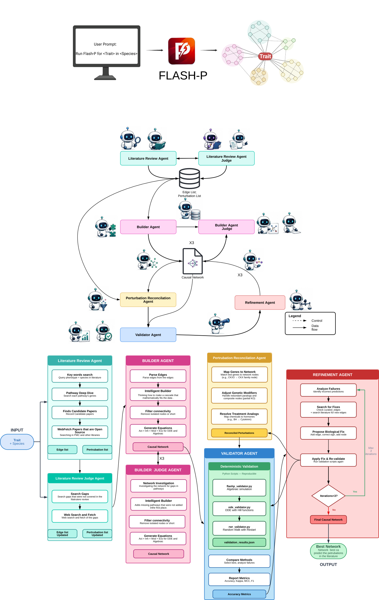

<p align="center">
  
</p>

<h1 align="center">FLASH-P</h1>

This distribution is based on upstream FLASH-P. See [NOTICE](NOTICE) for authorship,
the source repository, and the required copyright notice, and [LICENSE](LICENSE) for
the license terms.

<p align="center">
  <em>A multi-agent system that turns primary literature into validated,
  perturbation-testable causal networks &mdash; for any trait, in any species.</em>
</p>

<p align="center">
  <a href="#tldr--run-it-in-4-steps">TL;DR</a> &nbsp;&middot;&nbsp;
  <a href="#what-is-flash-p">What it is</a> &nbsp;&middot;&nbsp;
  <a href="#versions">Versions</a> &nbsp;&middot;&nbsp;
  <a href="#how-to-run">How to run</a> &nbsp;&middot;&nbsp;
  <a href="#commands">Commands</a> &nbsp;&middot;&nbsp;
  <a href="#whats-in-this-repo">Repo</a>
</p>

---

## TL;DR — run it in 4 steps

New here? This is the whole thing:

1. **Download the repo** — green **`Code ▸ Download ZIP`** at the top of this page (or `git clone`),
   then unzip it. Pick your version folder — start with **[`EviFork_Bio_Plant/`](EviFork_Bio_Plant)**.
2. **Open a terminal in the `Claude` subfolder** of that version — i.e. inside
   **`EviFork_Bio_Plant/Claude/`** — and start **[Claude Code](https://claude.com/claude-code)** there
   (run `claude`). That subfolder is the project root Claude Code should open.
3. **Run a command** — e.g. `/run-evifork-bio <trait> in <species>`. Don't want to approve every step?
   Press **`shift + tab`** to turn on auto-accept and let it run.
4. **Go do something fun ☕** — come back to a finished, DOI-backed network. Then
   `/run-evifork-bio-studio networks` to browse, perturb, and export it.

Want the details? Keep reading. New to the commands? Run **`/run-evifork-bio-help`** inside Claude Code.

### Conflict evidence hypothesis research extension

The local extension retains competing signed topologies, supports evidence reliability
calibration from independent audits, calibrates predictions, and ranks interventions by
expected information gain per cost. It adds grouped paper/intervention holdouts and
single-network, voting, and actual upstream-simulator baseline adapters.

From the repository root:

```bash
python -m evifork_bio demo --output my_runs/synthetic
python -m unittest discover -s tests -v
```

See [implementation and commands](evifork_bio/README.md),
[Agent workflow](research/EVIFORK_BIO_WORKFLOW.md), and
[executed evaluations](research_results/final/README.md).
The original pipeline remains available below. Current biological evaluations are
retrospective artifact holdouts; no new biological intervention was validated.

---

## What is FLASH-P?

FLASH-P reads primary scientific literature straight from the web and turns it into a validated,
perturbation-testable causal network for any (trait, species) pair. A sequence of specialised
agents &mdash; literature reviewer &rarr; judge &rarr; builder &rarr; judge &rarr; perturbation &rarr; validator &rarr; refiner &rarr;
exporter &mdash; pass strict handoff files to each other. Every edge carries a DOI; every node is wired
into algebraic, Hill-function ODE, and signed Random-Walk-with-Restart equations, so the network
is both human-readable and numerically simulable.

The agents are just plain-text prompts plus structured handoff files &mdash; nothing in them is tied to
one model or tool. **The same pipeline runs inside any coding agent that reads a `CLAUDE.md` or
`AGENTS.md` file** &mdash; we ship ready-to-go folders for Claude Code, Codex CLI, and OpenCode (which
also covers Aider, Goose, and any other AGENTS.md-aware tool).

<p align="center">
  
</p>

FLASH-P has already built **hundreds of networks**. The **13** shipped in [`Outcome/`](Outcome)
are the ones from the paper &mdash; built with the paper version of the agents: six Arabidopsis
phenotype networks, one merged six-trait network, and six other-species networks (*E. coli*, maize,
poplar, rice, sorghum, wheat). On a like-for-like benchmark they reach higher direction-call
accuracy than a cleaned knowledge-base baseline at a fraction of the size &mdash; see
[`Outcome/Upstream_Causal_Network_VS_KG/`](Outcome/Upstream_Causal_Network_VS_KG).

The bundled `Outcome/` results are inherited from upstream and describe retrospective
validation. Local computational evaluations are recorded separately in `research_results/`.
Neither set establishes prospective biological discovery.

---

## Versions

Pick the folder for your domain, then open the subfolder for your coding agent.

| Version | Use it for | Notes |
|---|---|---|
| **[`EviFork_Bio_Plant/`](EviFork_Bio_Plant)** | Plant & crop traits | **Start here.** The lean, current pipeline, tested most extensively. Ships Claude Code, Codex, and OpenCode variants. |
| **[`EviFork_Bio_Medical/`](EviFork_Bio_Medical)** | Medical traits | 🚧 **Alpha.** Same pipeline, medical tuning. Works, but **not yet tested as extensively** as Plant. Claude Code setup. |
| **[`EviFork_Bio_Animal/`](EviFork_Bio_Animal)** | Animal traits | 🚧 **Alpha.** Same pipeline, animal tuning. Works, but **not yet tested as extensively** as Plant. Claude Code setup. |
| **[`EviFork_Bio_Paper_Version/`](EviFork_Bio_Paper_Version)** | Reproducing the manuscript | The **original** pipeline behind the paper &mdash; full provenance and multi-pass judges, so **heavy on tokens**. Kept for reproducibility. The current versions above are far leaner with the same science. |

> **In short:** the current versions are very lean and fit a normal session; the paper version is
> the heavier original, kept only so the published results can be reproduced.

---

## How to run

Open the version folder for your domain, then the subfolder for your coding agent, and run the
pipeline for a trait and species (e.g. *Shoot Branching* in *Arabidopsis*).

### Claude Code

```bash
# install agentic coding platform (e.g. Claude Code)
npm install -g @anthropic-ai/claude-code   # or get the desktop app: https://www.claude.com/product/claude-code

# From the extracted project root, open the agent subfolder
cd EviFork_Bio_Plant/Claude
claude
```

Then run:

```text
/run-evifork-bio Shoot Branching in Arabidopsis
```

It runs the whole pipeline (Steps 1&rarr;6) autonomously and writes the network, validation, and
supplementary tables into a new `networks/<trait>/` folder.

### Codex / OpenCode / Aider / Goose

Open the matching subfolder &mdash; `EviFork_Bio_Plant/Codex/` or `EviFork_Bio_Plant/OpenCode_Aider_Any_Other/` &mdash;
start your agent there, and paste:

```text
Run the full FLASH-P pipeline for <trait> in <species>.
```

> **Open the agent subfolder, not the repo root** &mdash; the pipeline reads its orchestrator file
> (`CLAUDE.md` / `AGENTS.md`) and `Agent/*.md` as relative paths.
>
> **Medical & Animal** currently ship the Claude Code setup (`CLAUDE.md` + `Agent/`); open that
> folder in Claude Code and use the same `/run-evifork-bio` command.

---

## Commands

Once your agent is running in a version folder (e.g. `EviFork_Bio_Plant/Claude`), these slash commands are
available. Run **`/run-evifork-bio-help`** at any time to print this list from inside Claude Code.

| Command | What it does | Usage |
|---|---|---|
| `/run-evifork-bio` | Autonomously run the full pipeline (Steps 1&rarr;6) for a trait and write the network, validation, and supplementary tables into `networks/<trait>/`. | `/run-evifork-bio <trait> in <species>` |
| `/run-evifork-bio-studio` | Build the **FLASH-P Studio** &mdash; one self-contained, offline HTML app to browse, view (clickable, DOI links), **export** each network as PNG/SVG, and **perturbate** all your networks (KO/KD/OE + treatments; Algebraic / RWR / ODE solvers, live charts). | `/run-evifork-bio-studio <networks dir>` |
| `/run-evifork-bio-epistasis` | Gene &times; gene epistasis scan over an existing network &mdash; every single + double perturbation, classified by interaction. *(Plant)* | `/run-evifork-bio-epistasis <network dir>` |
| `/run-evifork-bio-gxe` | Gene &times; environment (G&times;E) scan over an existing network &mdash; dose-swept, with a report. *(Plant)* | `/run-evifork-bio-gxe <network dir>` |
| `/run-evifork-bio-help` | Print this command list from inside Claude Code (auto-generated from the commands available in the folder). | `/run-evifork-bio-help` |

> `/run-evifork-bio`, `/run-evifork-bio-studio`, and `/run-evifork-bio-help` ship in **Plant, Animal, and Medical**;
> `/run-evifork-bio-epistasis` and `/run-evifork-bio-gxe` currently ship in the **Plant** variant.

---

## What's in this repo

| Folder | Contents |
|---|---|
| `EviFork_Bio_Plant/`, `EviFork_Bio_Medical/`, `EviFork_Bio_Animal/` | The latest versions (see [Versions](#versions)). |
| `EviFork_Bio_Paper_Version/` | The original heavy-token pipeline used for the manuscript. |
| [`Outcome/`](Outcome) | All paper outputs: every network, validation result, refinement history, Cytoscape export, the KG-baseline comparison, and a local open-source-model reproduction. |
| [`Supplementary Data/`](Supplementary%20Data) | Seven supplementary `.xlsx` tables with build scripts and per-dataset descriptions. |
| [`Images/`](Images) | Banner and pipeline diagram. |

### Visualise in Cytoscape

Every network in [`Outcome/Networks/`](Outcome/Networks) ships as `.graphml` &mdash; drop one onto
Cytoscape and import [`Style_Cytoscape.xml`](Outcome/Networks/Style_Cytoscape.xml) (style
**FLASH-P**) to render it with the published palette. Full recipe in
[`Outcome/Networks/README.md`](Outcome/Networks/README.md).

---

## Upstream attribution and license

See [NOTICE](NOTICE) for upstream authorship, the original repository, and the required
copyright notice. The project retains its [CC BY-NC-SA 4.0 license](LICENSE).
If you use FLASH-P in academic work, please cite:
> Mitsanis C, Fortuna NZ, Beveridge C, Kainer D. **Turning decades of biology into accurate
> causal networks with AI agents.** _bioRxiv_ 2026.06.13.731799;
> doi: [10.64898/2026.06.13.731799](https://doi.org/10.64898/2026.06.13.731799)
